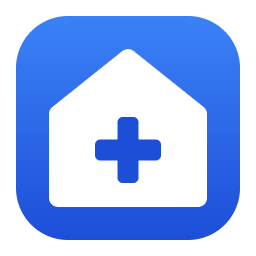
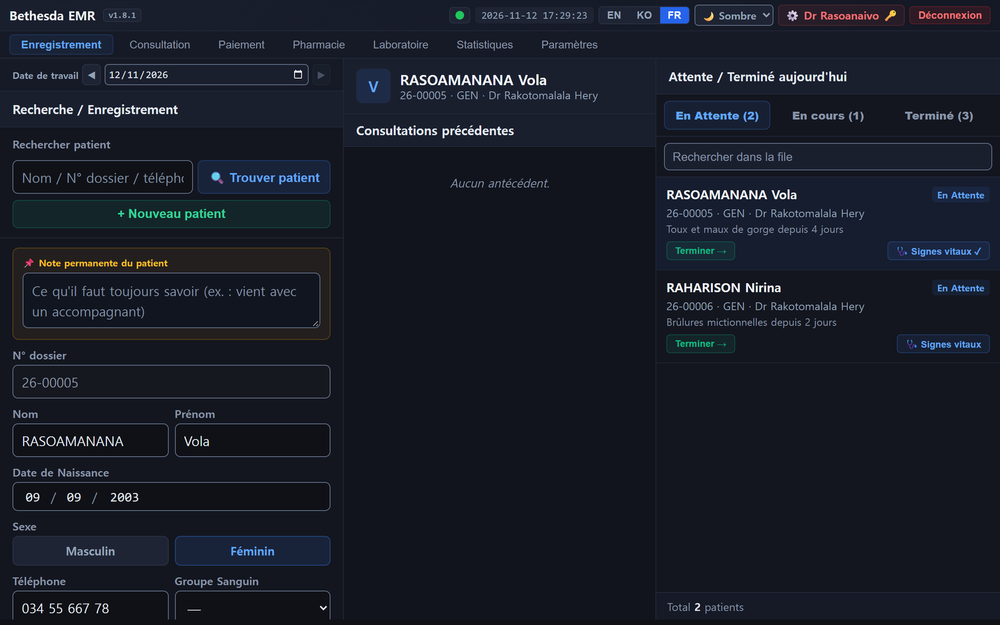
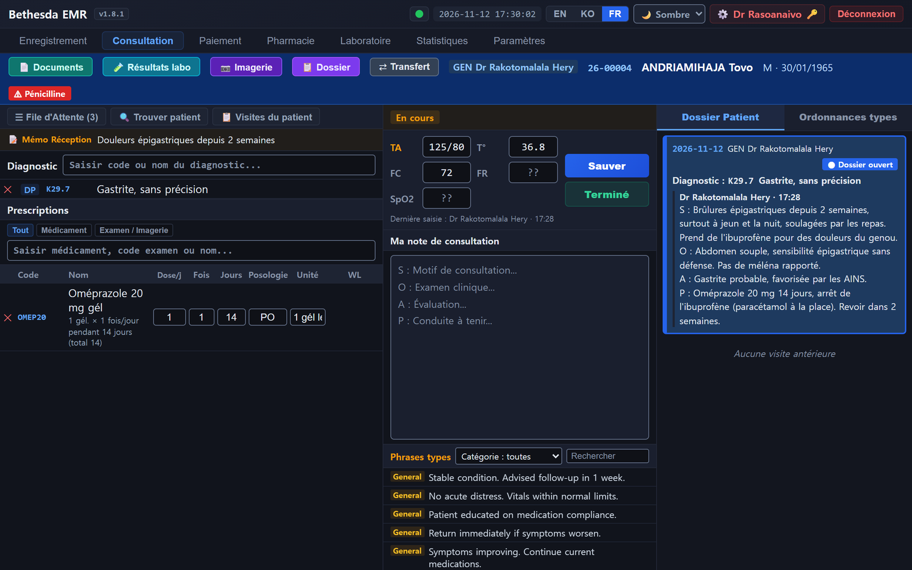
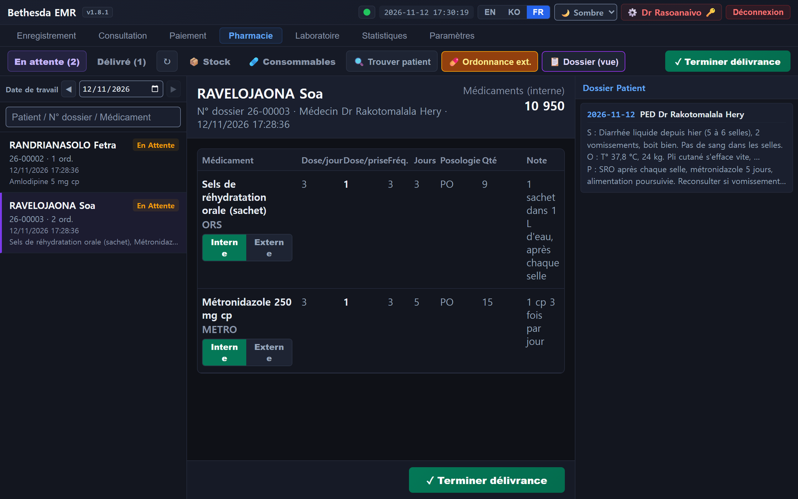
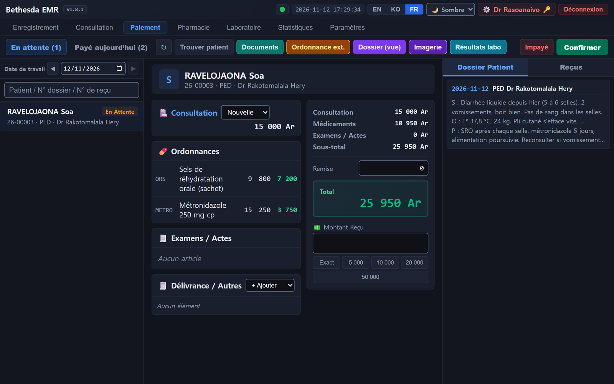
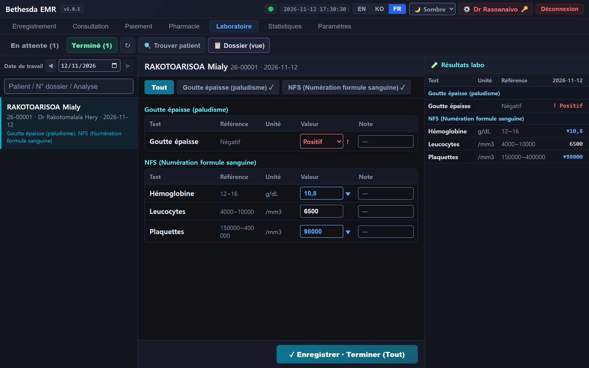
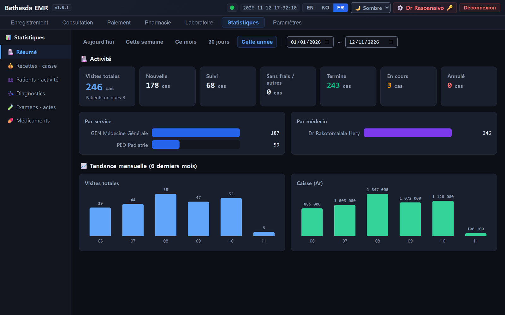
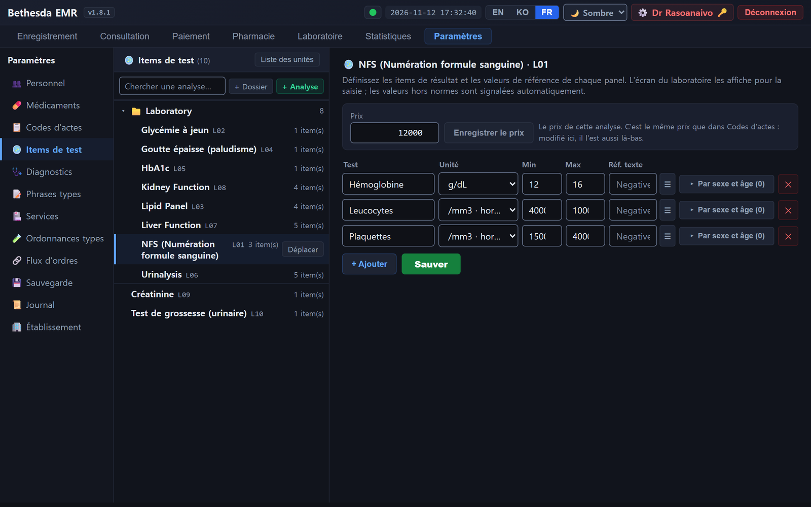
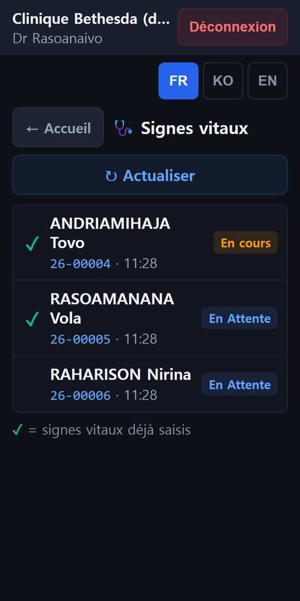

<p align="center">
  
</p>

<h1 align="center">Bethesda EMR</h1>

<p align="center">
  A complete electronic medical record for a small clinic, in one box.<br>
  Reception, consultation, pharmacy, laboratory, payment, statistics and medical imaging,
  running on one server in the clinic, with or without internet.
</p>

<p align="center">
  <a href="https://github.com/BethesdaHaneulNa/Bethesda-EMR/releases/latest"></a>
  <a href="LICENSE"></a>
  
  
</p>

---

Bethesda EMR was built for, and is used every day by, a small mission clinic in the highlands
of Madagascar: a few doctors and nurses, one reception desk, a pharmacy, a small laboratory
and an ultrasound machine, a server in a cupboard, and electricity and internet that come and
go. Everything a clinic like that needs to see a patient from the front door to the pharmacy
counter is in this one application, and it keeps working when the connection does not.

- **One server, any browser.** Install with Docker on one machine; staff open a web page on
  the clinic's network. No software on the desks.
- **Works offline.** An offline install kit puts the whole thing on a USB stick for sites
  with no usable internet, and updates come the same way.
- **French first**, English and Korean built in; the clinic chooses which of them its
  screens offer, and which currency its amounts are written in.
- **Nothing to configure before you start.** A new install is empty except for a few generic
  examples; the first login creates the administrator. Drugs, prices, tests, departments,
  letterhead and staff permissions are all edited in the app.
- **Backups by default**, a one-window status check anyone can read, and a printed staff
  guide in French.
- **Imaging included.** An optional PACS companion built on the open-source
  [Orthanc](https://www.orthanc-server.com/) server gives DICOM storage, a modality worklist
  for the ultrasound or X-ray machine, and image viewing inside the patient's chart.

This repository contains **no clinic data**: no patients, staff, drug or supply lists, prices
or site settings.

Copyright © 2026 Haneul Na and Bethesda EMR contributors. Free software under the
[GNU General Public License v3.0](LICENSE) (GPL-3.0-only).

## Screenshots

The screens below show demonstration data only (made-up patients and names).

<table>
  <tr>
    <td width="50%"><a href="docs/screenshots/reception.png"></a><br><sub><b>Reception</b> — register a patient, open a visit, follow the queue through the day.</sub></td>
    <td width="50%"><a href="docs/screenshots/consultation.png"></a><br><sub><b>Consultation</b> — SOAP note, diagnoses, prescription, lab and imaging orders, results, chart records.</sub></td>
  </tr>
  <tr>
    <td><a href="docs/screenshots/pharmacy.png"></a><br><sub><b>Pharmacy</b> — dispense in house or send out, with stock that follows.</sub></td>
    <td><a href="docs/screenshots/payment.png"></a><br><sub><b>Payment</b> — bill, receipt, outstanding balances, corrections.</sub></td>
  </tr>
  <tr>
    <td><a href="docs/screenshots/lab.png"></a><br><sub><b>Laboratory</b> — results with reference ranges and automatic flags.</sub></td>
    <td><a href="docs/screenshots/stats.png"></a><br><sub><b>Statistics</b> — visits, revenue, outstanding and drug use by day, month and year.</sub></td>
  </tr>
  <tr>
    <td><a href="docs/screenshots/settings.png"></a><br><sub><b>Settings</b> — staff and permissions, drugs, order codes, lab panels and order sets in folders, letterhead.</sub></td>
    <td align="center"><a href="docs/screenshots/mobile.png"></a><br><sub><b>On a phone</b> — vital signs, lab, imaging and orders from the ward.</sub></td>
  </tr>
</table>

Three screen themes (light, paper and dark); each account keeps its own.

## What it does

- **Reception** — patient records, chart numbers, visits and the day's queue, transfers
  between departments
- **Consultation** — SOAP notes, diagnoses, prescriptions, lab and imaging orders, order
  sets, chart records (operation notes, consents, …), lab results, radiology readings
- **Pharmacy** — in-house or external dispensing, stock receipts, counts and discards
- **Payment** — billing, receipts, void/refund/correction, outstanding balances
- **Laboratory** — clinical pathology entry with reference ranges and automatic flagging
- **Statistics** — visits, revenue, outstanding and drug use, by day, month and year
- **Settings** — staff and granular permissions, drugs, order codes, lab panels, departments,
  order sets, diagnosis codes, phrases, clinic letterhead, app title, languages,
  currency: all edited in the app, every change in a change log
- **Imaging** — with the optional PACS companion: DICOM storage, modality worklist, viewing
  inside the chart, radiology readings, export to CD

## Install

Only the server needs installing; staff open `http://<server address>:9080` in a browser.

1. Install [Docker](https://docs.docker.com/get-docker/) (Docker Desktop on Windows) and start it.
2. Download this repository (git clone, or **Code → Download ZIP** and unzip).
3. Run the setup once:

   ```sh
   ./setup.sh        # Linux / macOS / NAS
   .\setup.ps1       # Windows PowerShell (or double-click start.bat)
   ```

   On first run it writes a `.env` with random secrets (the database password and the
   session key - the repository has no defaults) and starts the stack at
   **http://localhost:9080**. Open it to create the administrator account; there is no
   default login.

**No internet at the clinic?** Build an offline kit on a connected machine
(`offline/pack.ps1`) and install it from a USB stick with `install-offline.ps1` - see
[OFFLINE-INSTALL.md](OFFLINE-INSTALL.md).

More in [DEPLOYMENT.md](DEPLOYMENT.md): backups (on by default), restoring, network
security, HTTPS, the PACS, and a go-live checklist.

## Update

- **Online:** `update.bat` (Windows) or `./update.sh`. It backs up the database, fetches
  the latest release, rebuilds and checks the app.
- **Offline kit:** `install-offline.ps1 -Update` from a newer kit keeps `.env`, backups and
  data, loads the new images and restarts. The **Mise à jour Bethesda** desktop shortcut
  does this in one click from the newest GitHub Release (`latest.json`) or from a kit on a
  USB stick.

Database migrations run by themselves on start; data is kept. What changed in each version
is in [CHANGELOG.md](CHANGELOG.md).

## Is it working? — the status window

Double-click **`server-status.bat`** on the machine that runs the clinic and leave the window
open. It re-checks every 15 seconds and shows one line per part of the system — patient records,
the application server, the EMR screen, disk space, last night's backup, imaging, and the device
worklist — in **Français / English / 한국어** (there is a button to switch).

It reads the machine directly rather than asking the EMR, so it keeps answering when the EMR
itself is the thing that broke — which is when you most need it. A green banner means everything
is working; red names what is not, in words a member of staff can repeat over the phone.

Several failures here are silent by nature: a backup that has not run for a month, a disk quietly
filling up, or an imaging worklist that stopped updating while every container still looks like it
is running. Those are the ones this window exists for.

For scripting, `powershell -File server-status.ps1 -Console` prints the same check once and exits
`0` when everything is fine, `1` if something needs attention, `2` if something is broken.

## Staff guide

A printed guide for the clinic's staff, in French, one chapter per module, is in
[docs/manual-fr](docs/manual-fr) (`node docs/manual-fr/build.mjs` makes one printable page).

## Releasing a kit

`offline/pack.ps1 -Zip` builds the kit, its `.sha256` and `latest.json`; publish the three
as one GitHub Release (`gh release create vX.Y.Z <kit>.zip <kit>.zip.sha256 latest.json`).
A kit contains third-party images (Orthanc, PostgreSQL, Debian and Alpine packages), so
handing it on is distribution under their licences: keep
[offline/THIRD-PARTY-NOTICE.md](offline/THIRD-PARTY-NOTICE.md) in it, and **keep a copy of
the corresponding source of the Orthanc release that the kit ships** (the tag pinned in the
PACS `docker-compose.yml`) for at least three years, to honour the written offer in that
notice.

## Architecture

- **PostgreSQL 16** + **Express (Node 20)** API + **React** front-end (served by nginx)
- One exposed port: **9080**
- Database migrations apply automatically on startup (`backend/sql`)
- Optional PACS (Orthanc, unmodified official image) as a separate stack on port 9090
- Every module has an API test set in `backend/test`, run against an isolated stack

Contributions: see [CONTRIBUTING.md](CONTRIBUTING.md). Questions and bug reports: open an
issue.

## Licence

Bethesda EMR is free software: you can redistribute it and/or modify it under the terms of
the GNU General Public License as published by the Free Software Foundation, version 3.
It is distributed in the hope that it will be useful, but WITHOUT ANY WARRANTY; without
even the implied warranty of MERCHANTABILITY or FITNESS FOR A PARTICULAR PURPOSE. See
[LICENSE](LICENSE) for the full text and [NOTICE](NOTICE) for third-party software.

Whoever deploys it is responsible for configuring it safely (secrets, backups, network)
and for using it in line with local law on medical data.

This software was developed with the help of Claude (Anthropic's Claude Code).
